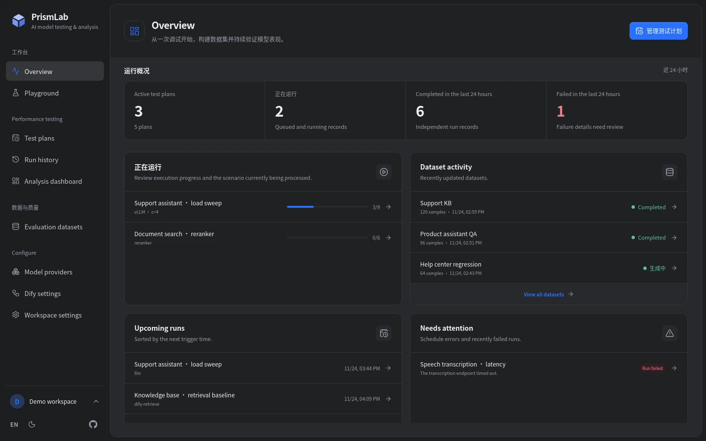
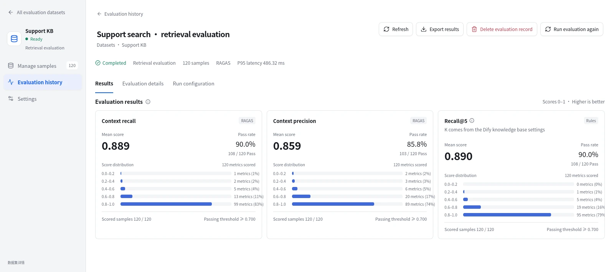

<p align="center">
  <picture>
    <source media="(prefers-color-scheme: dark)" srcset="frontend/public/brand/prismlab-mark-dark.svg">
    
  </picture>
</p>

<h1 align="center">PrismLab</h1>

<p align="center"><strong>An open-source workbench for AI performance testing and RAG evaluation.</strong></p>

<p align="center">
  <a href="http://60.171.108.62:8441/#overview">Live workspace</a> ·
  <a href="#quick-start">Quick start</a> ·
  <a href="docs/README.md">Documentation</a> ·
  <a href="README_zh-Hans.md">简体中文</a>
</p>



Connect your own model endpoints and Dify apps. Start with one request in Playground, then turn it into a repeatable benchmark or a dataset-backed quality evaluation.

## What you can do

- **Benchmark performance.** Test LLM, Embedding, Reranker, Audio and Dify under different concurrency levels. Compare P95 latency, throughput and streaming metrics across runs.
- **Evaluate RAG and retrieval.** Build datasets from documents or Dify, freeze the samples for each run, then score answers and retrieval with RAGAS, DeepEval or ranking rules.
- **Debug individual requests.** Stream responses in Playground and open a recorded dataset generation step with its prompts and supported model parameters prefilled.

## Quick start

Requires Docker and Docker Compose v2. Clone the repository and copy the environment template.

```bash
git clone https://github.com/leslie2046/PrismLab.git
cd PrismLab
cp docker/.env.example docker/.env
```

Configure sign-in and database credentials in `docker/.env`. The [Docker guide](docker/README.md) lists the required settings.

```bash
docker compose --env-file docker/.env -f docker/compose.yaml up --build -d
```

Open [localhost:8080](http://localhost:8080), add a model endpoint or Dify connection, and send one request in Playground.

[Local development](docs/repository-layout.md#运行入口) · [CLI benchmarks and metrics](docs/cli-reference.md) · [Workspaces and permissions](docs/tenancy.md) · [MIT license](LICENSE)

## Retrieval evaluation preview



<sub>Screenshots show the live interface with example data.</sub>
