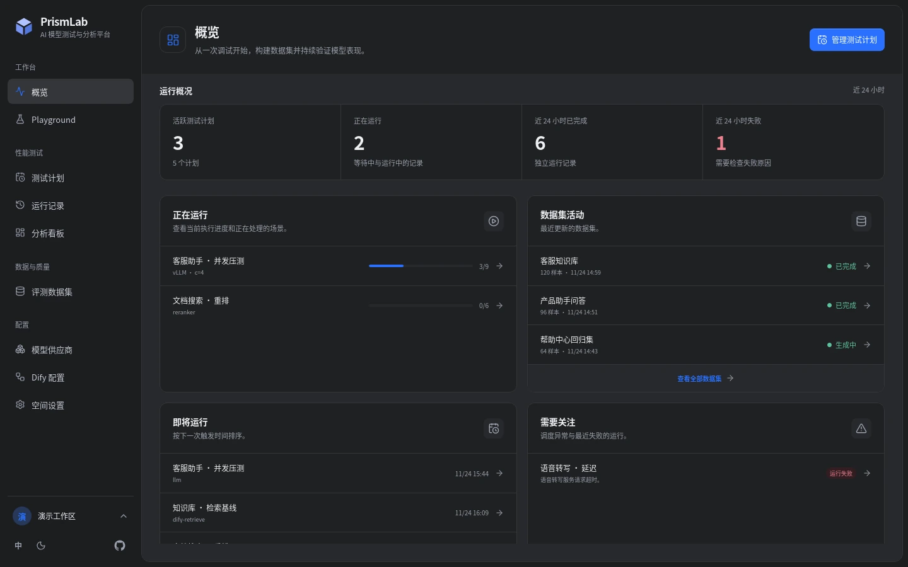
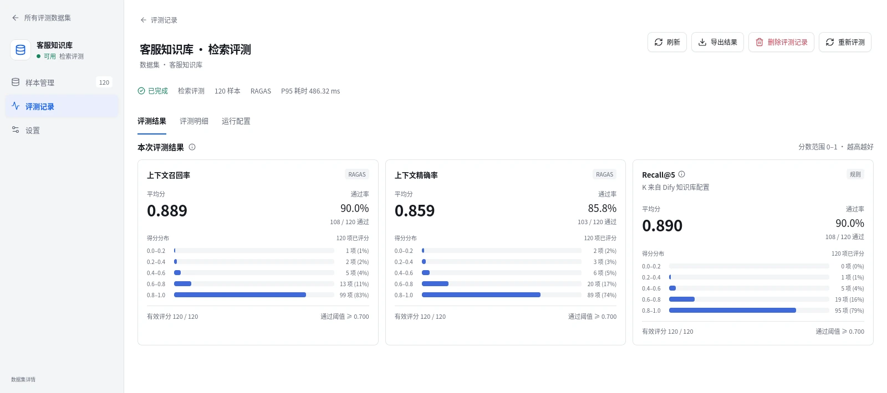

<p align="center">
  <picture>
    <source media="(prefers-color-scheme: dark)" srcset="frontend/public/brand/prismlab-mark-dark.svg">
    
  </picture>
</p>

<h1 align="center">PrismLab · 棱镜实验室</h1>

<p align="center"><strong>开源的 AI 性能测试与 RAG 质量评测工作台。</strong></p>

<p align="center">
  <a href="http://60.171.108.62:8441/#overview">在线工作台</a> ·
  <a href="#快速开始">快速开始</a> ·
  <a href="docs/README.md">项目文档</a> ·
  <a href="README.md">English</a>
</p>



接入自己的模型服务和 Dify 应用。从 Playground 的一次请求开始，逐步建立可重复运行的性能测试和质量评测。

## 能做什么

- **测性能。** 对 LLM、Embedding、Reranker、Audio 和 Dify 进行并发压测，对比不同运行的 P95 延迟、吞吐量和流式指标。
- **评答案与检索。** 从文档或 Dify 构建数据集，为每次评测冻结样本，使用 RAGAS、DeepEval 或排序规则评分。
- **调试单次请求。** 在 Playground 查看流式输出，也可从样本的生成记录直接带入某一步的提示词和支持的模型参数。

<details>
<summary>查看检索评测结果</summary>



</details>

<sub>截图来自线上界面，使用演示数据。</sub>

## 快速开始

需要 Docker 和 Docker Compose v2。先克隆仓库并复制配置模板。

```bash
git clone https://github.com/leslie2046/PrismLab.git
cd PrismLab
cp docker/.env.example docker/.env
```

在 `docker/.env` 中配置登录与数据库凭据，所需设置见 [Docker 部署指南](docker/README.md)。

```bash
docker compose --env-file docker/.env -f docker/compose.yaml up --build -d
```

打开 [localhost:8080](http://localhost:8080)，添加模型服务或 Dify 连接，在 Playground 发送一次请求。

[本地开发](docs/repository-layout.md#运行入口) · [CLI 压测与指标](docs/cli-reference.md) · [空间与权限](docs/tenancy.md) · [MIT 许可证](LICENSE)
